# The launcher: user manual

The pictures are the launcher's own screens, drawn by `make ui-snap` with
sample phones and names.

## The idea

The launcher is a detour, not a home. In the car you live in CarPlay or in
the car's own BMW screens; the launcher appears when you ask for it, or when
no phone connects by itself, and steps aside as soon as its job is done.

## Getting in and out

| You want | Do |
| --- | --- |
| The unit's picture, from the BMW picture | Touch the screen: CarPlay if a session is running, otherwise the launcher |
| To switch between the BMW picture and the unit's (CarPlay if a session is up, otherwise the launcher) | Long press MENU on the controller |
| Back to the BMW picture, from the launcher's Home | The controller's Back, or MENU |
| The BMW picture, from CarPlay | CarPlay's car icon, or a short press of MENU |
| Back into CarPlay | Touch the screen, or long press MENU |

Every launcher screen works with the controller's knob (turn to move the
amber ring, push to choose, Back to go up) and by touch.

Inside CarPlay the knob is CarPlay's: turn moves its selection, push
chooses, and Back is CarPlay's own Back. MENU stays the car's.

## Home

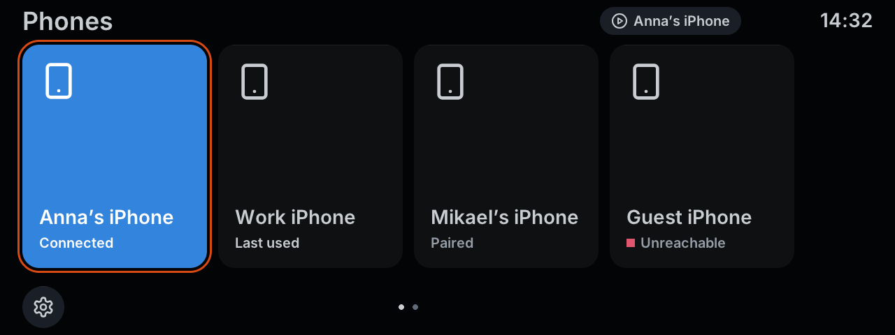

Your paired phones as tiles, four to a page; swipe or keep turning for the
next page. Each phone is in one state:

| State | Meaning |
| --- | --- |
| **Connected** (blue tile) | CarPlay is running with this phone. Push it to go to CarPlay. |
| **Last used** | The phone connected most recently. The ring starts here. |
| **Paired** | Known to the unit. Push it to connect. |
| **Unreachable** (red square) | The last attempt to connect failed. Push to try again; it clears at the next ignition. |

At the top: the phone CarPlay is running with, the Bluetooth mark (there
when Bluetooth is up, with a short line at either side when a phone is
connected), and the clock, which is the car's own time once the car has
said it. The cog under the tiles opens Settings.

**Pair a phone** is always the last tile, so Home is never empty:

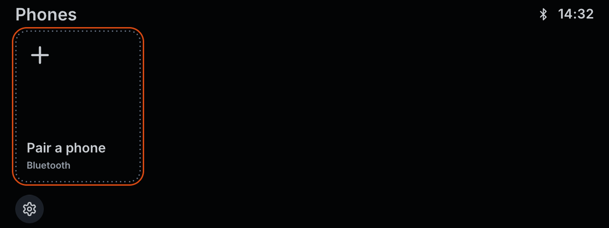

## Connecting and pairing

Pushing a tile shows one line and a spinner for as long as the unit is
trying: usually 15 to 20 seconds. When CarPlay is up the picture switches to
it by itself. If an attempt has to be repeated the line becomes "Still
trying …". **Cancel**, or the controller's Back, returns to Home.

If the unit gives up, it says so for three seconds and returns to Home with
the tile marked Unreachable:

Pairing uses the same screen. Push **Pair a phone**, then choose the unit by
its name in the phone's Bluetooth settings and confirm the code on the
phone:

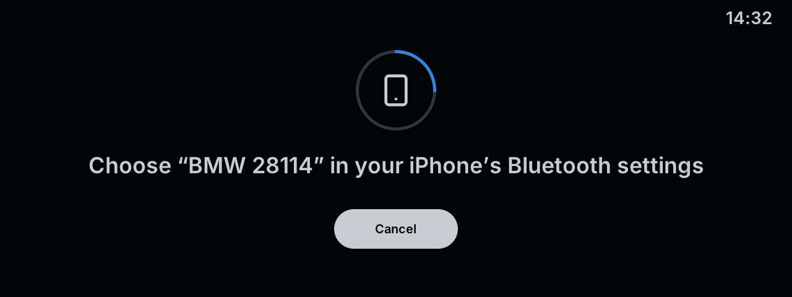

## Two phones in the car

When CarPlay has just come up and another phone is paired, a banner offers
the other one for eight seconds. Tap it to switch; tap beside it, or wait,
and it goes. "Offer other phone in CarPlay" (General) turns it off.

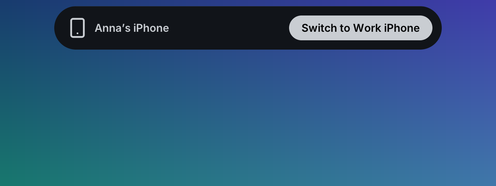

A phone that is not the one in CarPlay is kept off the unit's hands-free and
off its Wi-Fi: after a switch the unit's Wi-Fi gets a new passphrase that
only the chosen phone is given (not while Developer access is on: the
passphrase stays then).

## Driver profiles

If the car's driver profile is known to the unit, each profile can have its
phone, and that phone is connected at ignition without the launcher showing
at all. **This needs the optional MCU patch** (`mcu/profile`), which makes
the MCU pass the profile on; without it nothing connects by itself: touch
the screen and push a tile.

- A profile without a phone waits on Home and says so. The phone you connect
  or pair there becomes that profile's phone, once CarPlay is up with it:

  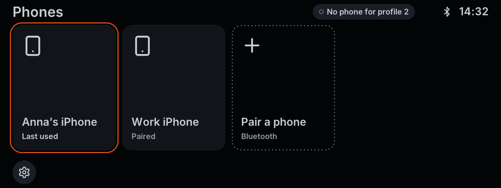

- Under the Guest profile nothing is remembered and the switch banner is
  not shown:

  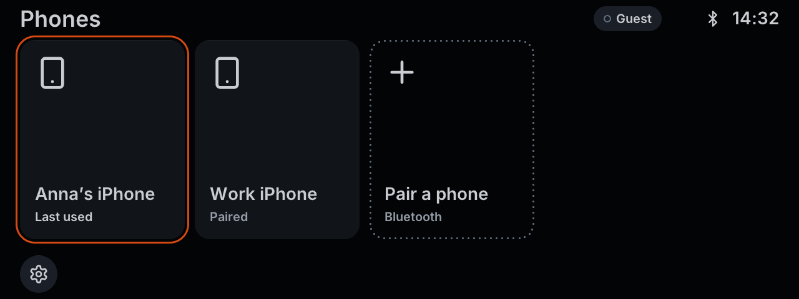

- Choosing another phone on Home while the profile has one is for this
  drive only.
- "Connect at ignition" (General) set to Off means the unit never connects
  by itself.

A phone's own list (General → Paired phones → the phone) has a **Driver
profile** row: None, or Profile 1 to 3. Giving a phone a profile that
another phone holds moves the profile to it.

## Settings

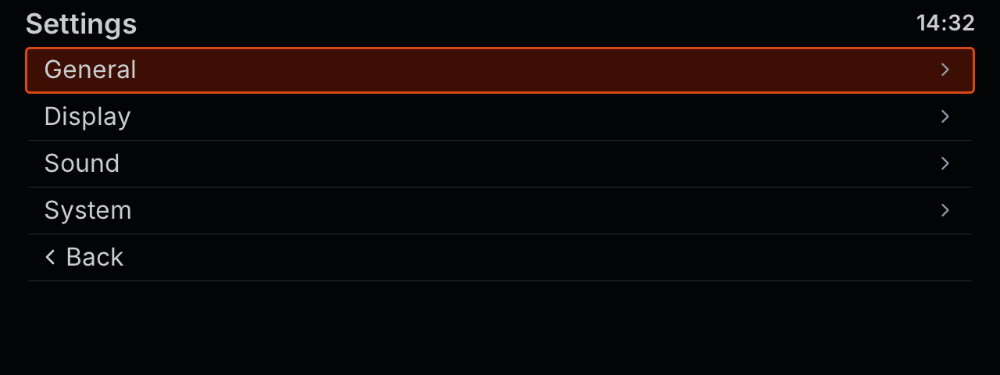

Lists, as in the car's own settings. A row with a chevron opens a list; a
row with a value steps to its next value when pushed; an amount is changed
by pushing it and turning. Every list ends in **Back**.

### General

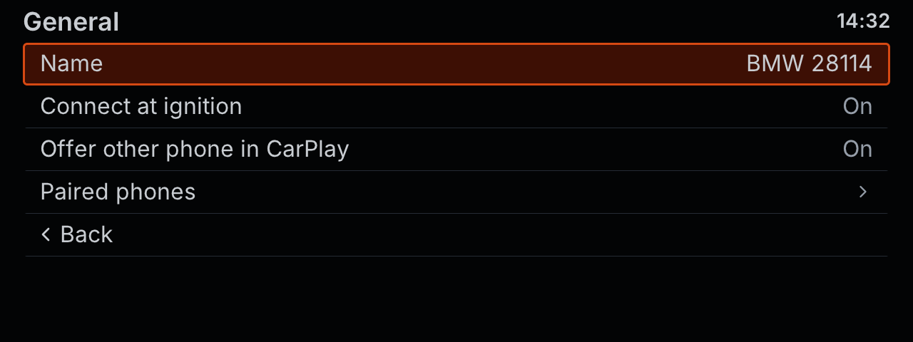

- **Name**: the name the unit shows to phones, over Bluetooth and Wi-Fi.
- **Connect at ignition**, **Offer other phone in CarPlay**: see above.
- **Paired phones**: the list of phones; each opens its own list.

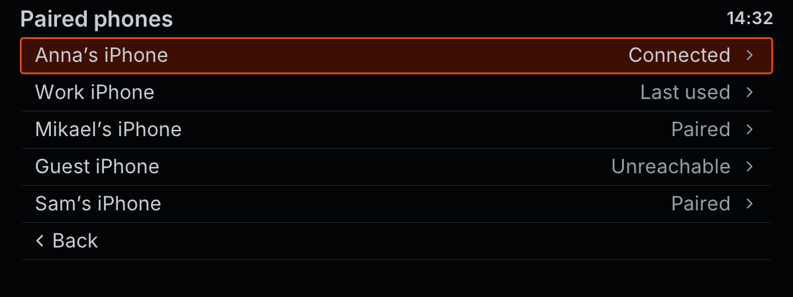
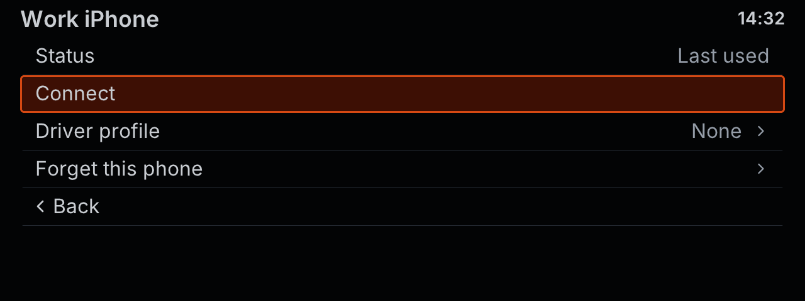

**Connect** or **Disconnect** act at once. **Forget this phone** asks first,
with the ring on Cancel:

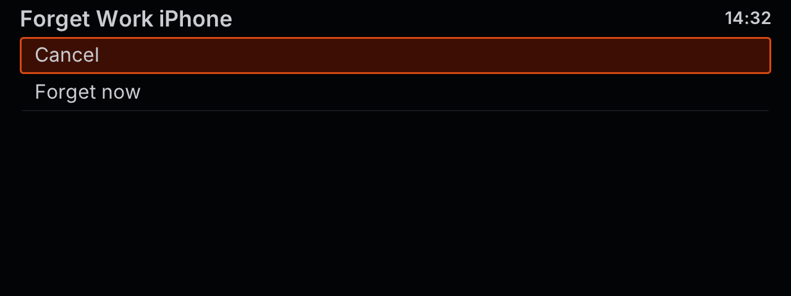

### The name

Opened with the knob, the name is typed on a dial (turn, push to type; the
functions are along the bottom). Opened by touch, on a keyboard. Either
changes into the other as soon as you use the other hand.

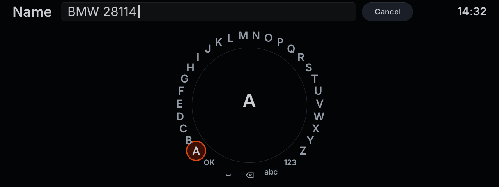
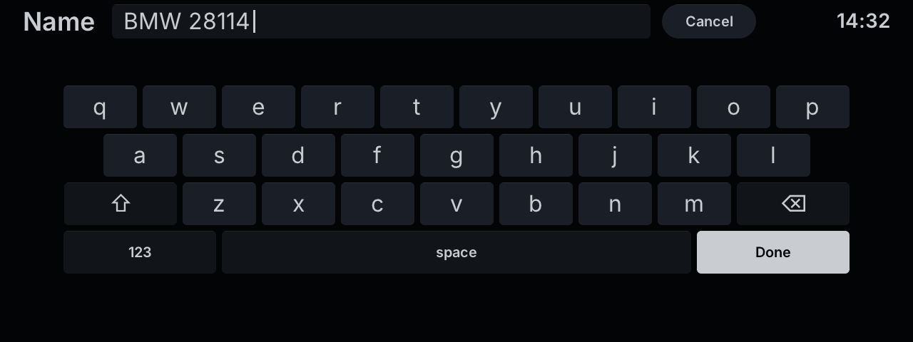

A phone keeps the name it first saw for its list of cars until the phone is
restarted; the label on the car's tile follows at the next connection.

### Display

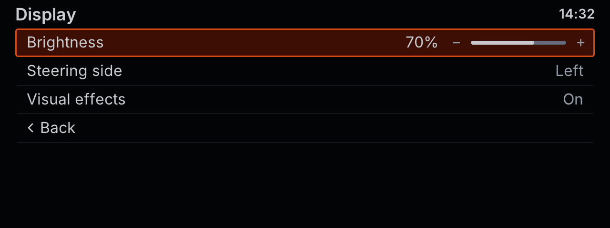

- **Brightness**.
- **Steering side**: which end the cog and a part-filled row of tiles stand
  at.

  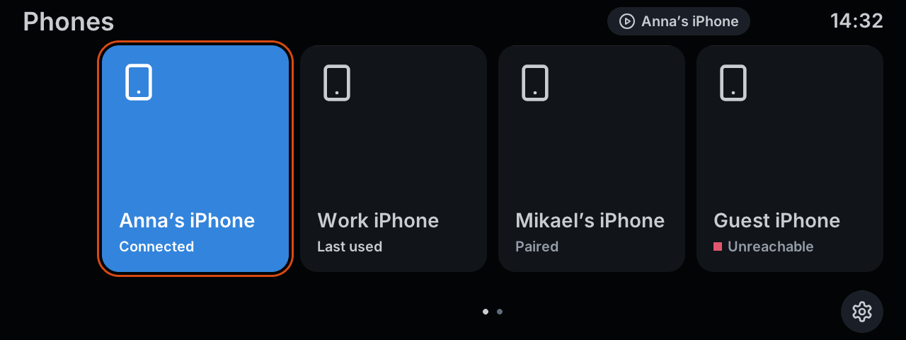

- **Visual effects**: On moves screens in and out and fades into CarPlay;
  Off cuts.

### Sound

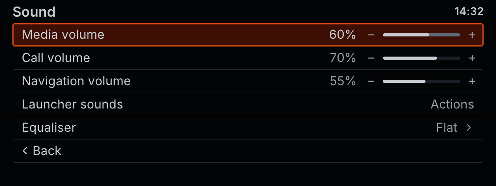

- **Launcher sounds**: Off, Actions (everything but the tick of each knob
  step), or All.
- The three volumes and the equaliser are shown dimmed: **not working yet**.

### System

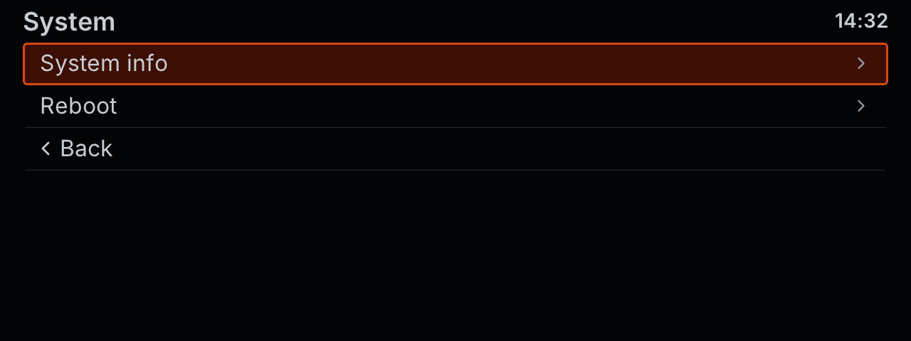
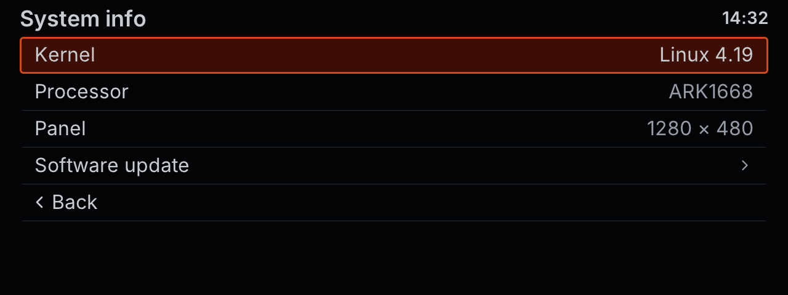

- **System info**: what runs, and **Software update**.
- **Developer access**: only in an image built with a developer's key
  ([developer-access.md](developer-access.md)); Off unless switched on.
- **Reboot**: asks first.

## Software update

Do this parked, with the phone in your hand and the update file on it
(a `.bundle` file made with `make app-bundle`).

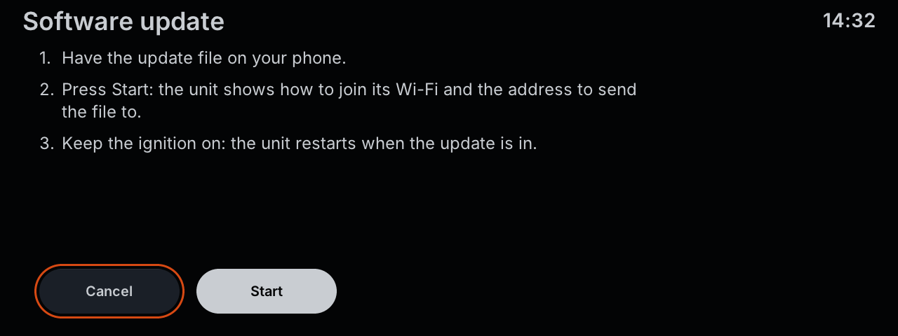

1. **Start.** The unit shows a code: point the phone's camera at it and
   join the unit's Wi-Fi. The name and passphrase are beside it for joining
   by hand. The next step follows by itself when the phone has joined;
   **Next** is there if it was on that Wi-Fi already.

   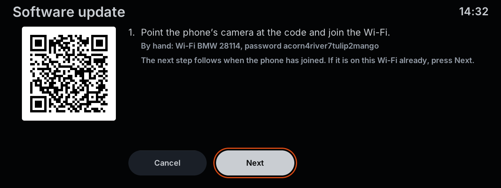

2. **Type the address** shown into the phone's browser (a phone opens a
   plain `http://` address only when it is typed), choose the file there and
   send it.

   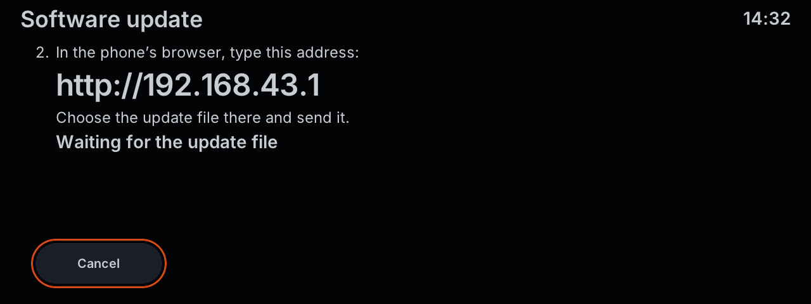

3. The unit checks the file, says "Updating. Keep the ignition on" and
   restarts into the new software. If the new software does not start
   properly twice, the unit goes back to what it ran before by itself.

The page in the phone's browser also has **Save this session's logs**, for
when someone asks you for them.

Nothing listens before Start or after you leave the screen.
